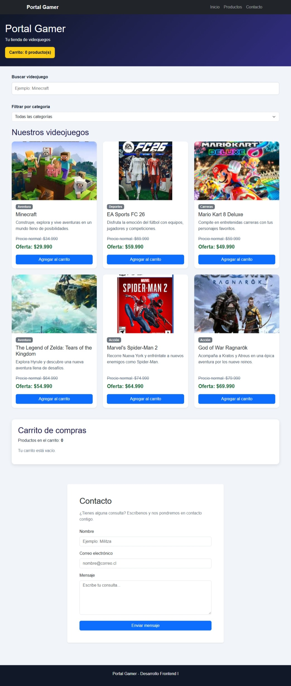
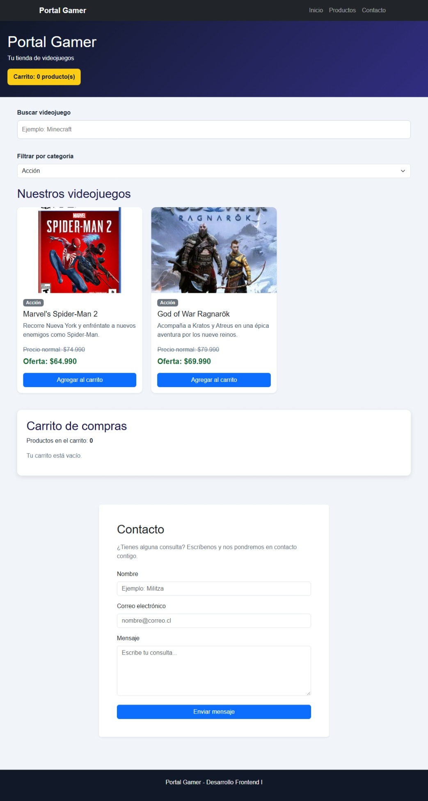
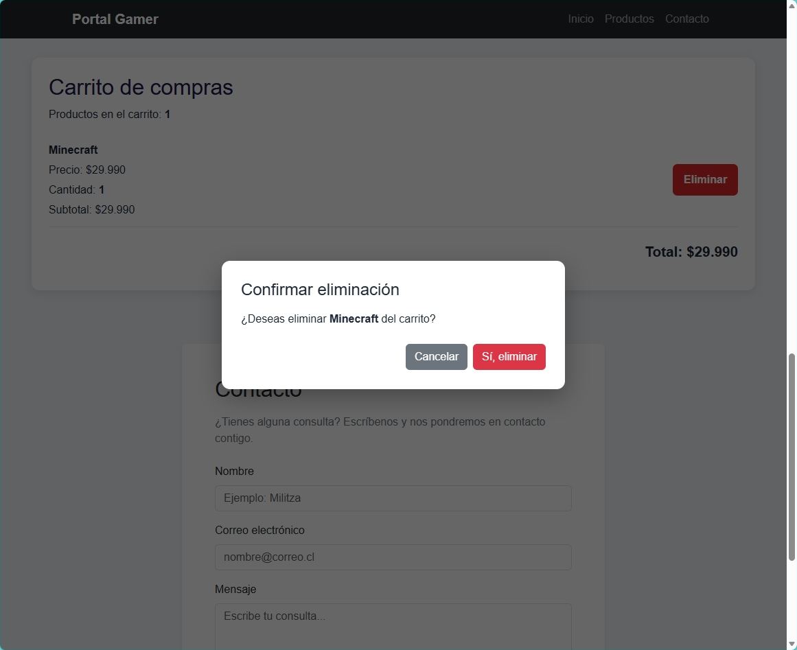
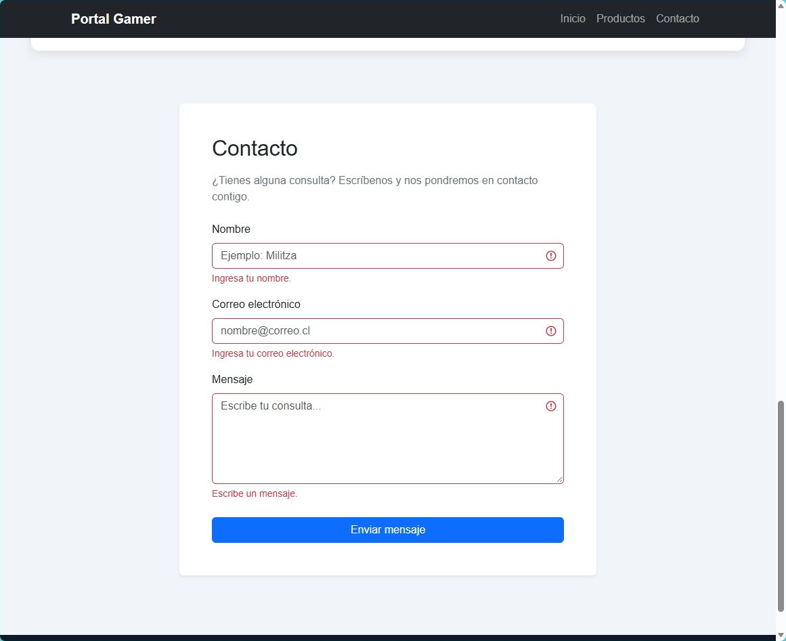
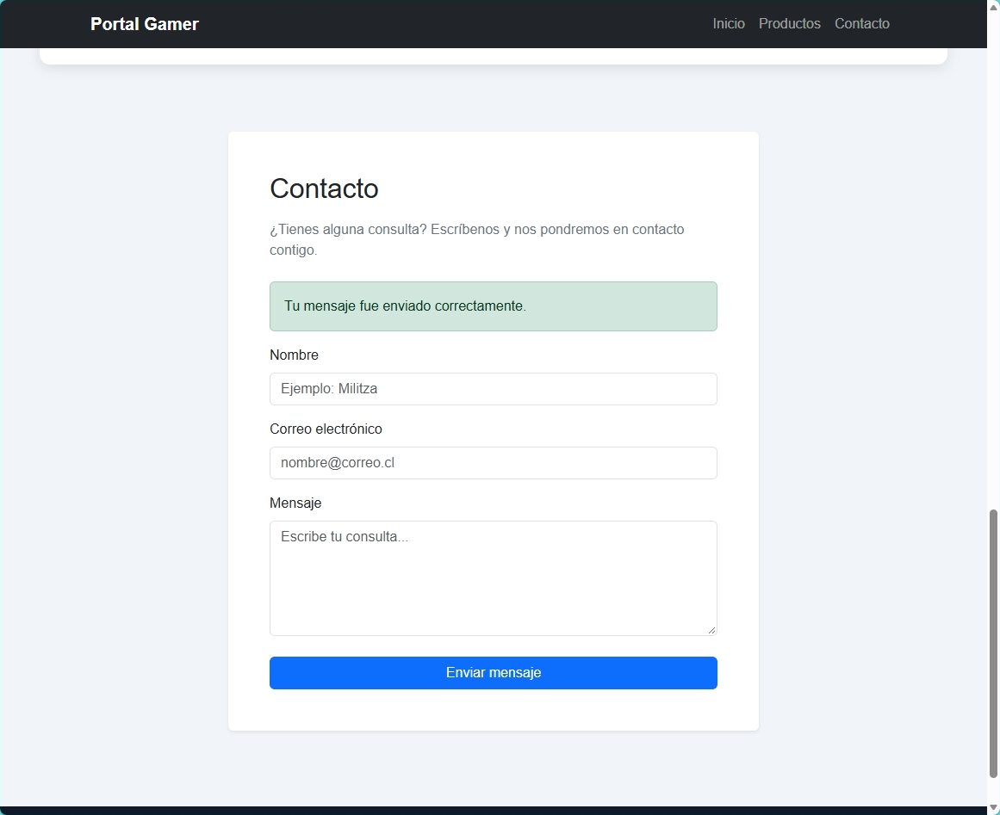
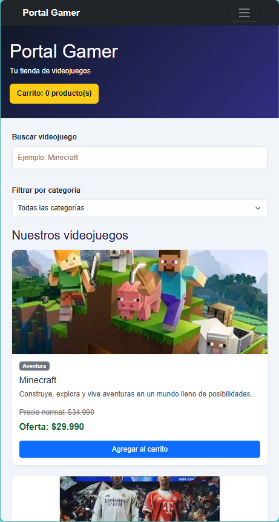

# Portal Gamer - Evaluación Final Transversal

Proyecto desarrollado para la asignatura **Desarrollo Frontend I (PFY2201)**.

## Evaluación

**Semana 9 - Evaluación Final Transversal (EFT)**

Portal Gamer corresponde a un sitio web para una tienda de videojuegos, desarrollado utilizando las tecnologías y funcionalidades trabajadas durante la asignatura.

---

## Objetivo del proyecto

Desarrollar un sitio web funcional para la venta de videojuegos utilizando:

- HTML5
- CSS3
- JavaScript
- Bootstrap 5
- React
- Git y GitHub

La aplicación permite visualizar videojuegos, buscar productos, filtrar por categoría, gestionar un carrito de compras y utilizar un formulario de contacto con validaciones.

---

## Tecnologías utilizadas

- HTML5
- CSS3
- JavaScript
- React
- JSX
- Vite
- Bootstrap 5
- React Hooks
  - `useState`
  - `useEffect`
  - `useRef`
- Fetch API
- Web Storage API (`localStorage`)
- Git
- GitHub
- GitHub Pages

---

## Funcionalidades principales

### Catálogo dinámico de videojuegos

Los videojuegos se cargan dinámicamente desde:

```text
public/productos.json
```

La aplicación utiliza `fetch` para obtener los datos y React para generar las tarjetas dinámicamente.

Cada videojuego contiene:

- Imagen
- Nombre
- Categoría
- Descripción
- Precio normal
- Precio de oferta

---

## Bootstrap 5

Bootstrap 5 se utiliza para mejorar la estructura visual y responsiva del proyecto.

Se implementaron:

- Barra de navegación responsive.
- Tarjetas de productos.
- Sistema Grid.
- Botones.
- Badges de categorías.
- Formularios.
- Mensajes de validación.
- Alertas visuales.

La cuadrícula se adapta según el dispositivo:

```text
Móvil       → 1 tarjeta por fila
Tablet      → 2 tarjetas por fila
Escritorio  → 3 tarjetas por fila
```

---

## Barra de navegación

La aplicación incorpora una barra de navegación responsive con enlaces a:

- Inicio
- Productos
- Contacto

En dispositivos pequeños la navegación se transforma automáticamente en un menú hamburguesa.

---

## Buscador

El buscador permite filtrar videojuegos por nombre en tiempo real.

Se utiliza el evento:

```text
onChange
```

para actualizar el estado de React mientras la persona escribe.

---

## Filtro por categoría

Los videojuegos pueden filtrarse mediante un selector de categorías.

Categorías disponibles:

- Todas las categorías
- Aventura
- Acción
- Deportes
- Carreras

El listado se actualiza dinámicamente utilizando estado de React.

---

## Carrito de compras

El carrito permite:

- Agregar videojuegos.
- Agregar varias unidades del mismo videojuego.
- Mostrar la cantidad total de productos.
- Calcular subtotales.
- Calcular el total de la compra.
- Eliminar productos.
- Mantener los productos después de recargar la página.

La persistencia del carrito se realiza mediante:

```text
localStorage
```

---

## Modal de confirmación React

Para evitar eliminaciones accidentales se implementó un componente React:

```text
ModalConfirmacion.jsx
```

El modal reemplaza el uso de `window.confirm`.

Incluye:

- Confirmación visual antes de eliminar.
- Botón Cancelar.
- Botón Sí, eliminar.
- Gestión mediante estado de React.
- Cierre mediante tecla `Escape`.
- Manejo de foco.
- Atributos de accesibilidad `aria`.

---

## Formulario de contacto

La aplicación incluye un formulario de contacto con los campos:

- Nombre
- Correo electrónico
- Mensaje

El formulario valida los datos antes del envío.

### Validaciones

Se verifica que:

- El nombre no esté vacío.
- El correo electrónico no esté vacío.
- El correo tenga un formato válido.
- El mensaje no esté vacío.
- El mensaje tenga al menos 10 caracteres.

Cuando existen errores, Bootstrap muestra los campos y mensajes correspondientes en color rojo.

Si la información es correcta se muestra:

```text
Tu mensaje fue enviado correctamente.
```

Después del envío los campos se limpian automáticamente.

---

## Gestión de estados con React

La aplicación utiliza `useState` para controlar:

- Productos.
- Carrito.
- Buscador.
- Categoría seleccionada.
- Estado de carga.
- Estado de error.
- Notificaciones.
- Producto seleccionado para eliminación.
- Datos y errores del formulario.

---

## Efectos con `useEffect`

Se utiliza `useEffect` para:

- Cargar los productos al iniciar la aplicación.
- Sincronizar el carrito con `localStorage`.
- Ocultar notificaciones automáticamente.
- Gestionar comportamiento del modal.

---

## Manejo de errores y reintentos

La carga de productos incluye manejo de errores mediante `try/catch`.

También se implementaron:

- Registro de errores mediante `console.error`.
- Registro de intentos mediante `console.info`.
- Identificación de códigos HTTP.
- Máximo de 3 intentos.
- Espera configurable entre reintentos.
- Mensaje comprensible para la persona usuaria.
- Botón manual `Reintentar`.

Configuración utilizada:

```javascript
const CONFIG_CARGA = {
  intentosMaximos: 3,
  esperaMs: 800,
}
```

---

## Renderizado condicional

La aplicación utiliza renderizado condicional para mostrar distintas vistas según el estado.

Ejemplos:

- `Cargando videojuegos...`
- Mensaje de error de carga.
- Botón `Reintentar`.
- Carrito vacío.
- Búsqueda sin resultados.
- Producto agregado al carrito.
- Modal de confirmación.
- Mensaje de formulario enviado correctamente.

Cuando un producto ya se encuentra en el carrito, el botón cambia de:

```text
Agregar al carrito
```

a:

```text
En el carrito ✓
```

---

## Notificaciones

Al agregar o eliminar un videojuego se muestra una notificación temporal.

Ejemplo:

```text
Minecraft fue agregado al carrito.
```

o:

```text
Minecraft fue eliminado del carrito.
```

Las notificaciones desaparecen automáticamente después de unos segundos.

---

## Componentes React

El proyecto se divide en componentes reutilizables:

```text
src/
├── components/
│   ├── Carrito.jsx
│   ├── ContactoForm.jsx
│   ├── FiltroCategorias.jsx
│   ├── ListaProductos.jsx
│   ├── ModalConfirmacion.jsx
│   ├── Navbar.jsx
│   └── ProductoCard.jsx
├── App.css
├── App.jsx
├── index.css
└── main.jsx
```

Esta estructura permite mantener separadas las responsabilidades de cada componente.

---

## Estructura principal

```text
tienda-videojuegos/
├── capturas/
│   └── semana9/
│       ├── 01-catalogo-bootstrap.png
│       ├── 02-filtro-categoria.png
│       ├── 03-modal-eliminacion.png
│       ├── 04-formulario-validacion.png
│       ├── 05-formulario-exitoso.png
│       └── 06-responsive-movil.png
│
├── semana9-react/
│   ├── public/
│   │   ├── img/
│   │   └── productos.json
│   ├── src/
│   │   ├── components/
│   │   ├── App.css
│   │   ├── App.jsx
│   │   ├── index.css
│   │   └── main.jsx
│   ├── package.json
│   ├── package-lock.json
│   └── vite.config.js
│
└── README.md
```

---

## Instalación

Clonar el repositorio:

```bash
git clone https://github.com/MiliDuoc/PFY2201-Semana9-Portal-Gamer.git
```

Entrar al proyecto React:

```bash
cd PFY2201-Semana9-Portal-Gamer/semana9-react
```

Instalar las dependencias:

```bash
npm install
```

---

## Ejecución local

Ejecutar:

```bash
npm run dev
```

Luego abrir la dirección entregada por Vite en el navegador.

---

## Validación del código

El código fue comprobado mediante:

```bash
npm run lint
```

Resultado:

```text
Found 0 warnings and 0 errors.
```

---

## Build de producción

Se verificó la compilación mediante:

```bash
npm run build
```

Resultado:

```text
✓ 26 modules transformed.
✓ built successfully
```

---

## Evidencias

### 1. Catálogo con Bootstrap 5



### 2. Filtro por categoría



### 3. Modal React para eliminación



### 4. Validación del formulario



### 5. Formulario enviado correctamente



### 6. Diseño responsive móvil



---

## Repositorio GitHub

https://github.com/MiliDuoc/PFY2201-Semana9-Portal-Gamer

---

## GitHub Pages

https://miliduoc.github.io/PFY2201-Semana9-Portal-Gamer/

---

## Asignatura

**Desarrollo Frontend I**

**PFY2201**

**Semana 9 - Evaluación Final Transversal**